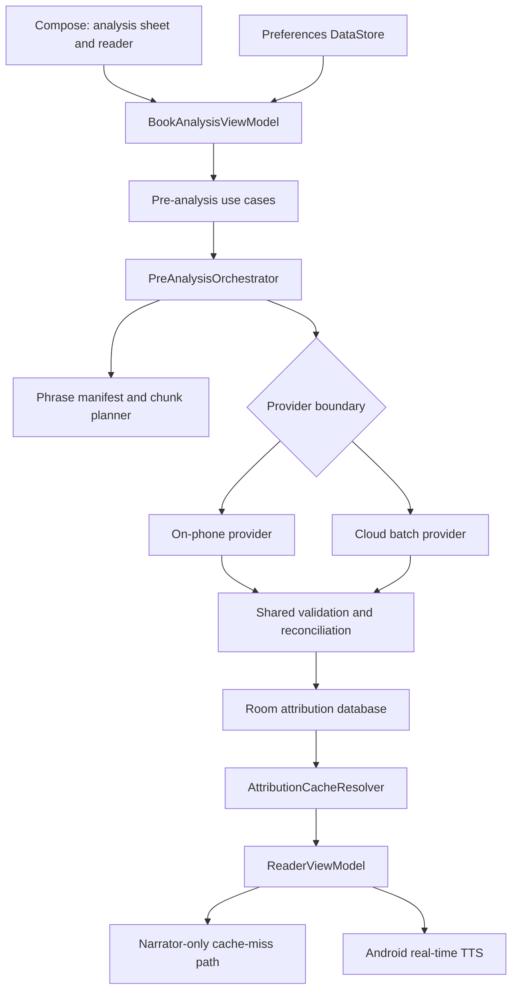
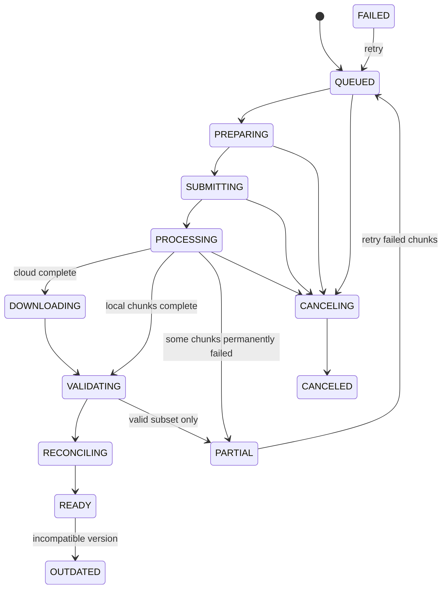

# VoxReader whole-book pre-analysis: implementation and design plan

> **Status: deferred and not implemented.** This is a design reference, not current product
> behavior. See [current state](../memory/STATE.md) before scheduling any part of it.

## Document status

This document designs two future VoxReader features:

1. overnight, fully on-phone character and speaker pre-recognition; and
2. explicitly enabled, paid cloud pre-recognition using a batch-capable model provider such as
   Claude Haiku.

It is an implementation plan, not a description of currently shipped behavior. Both paths would produce
the same local attribution cache, character registry, and voice assignments. The reader consumes
that cache without knowing which provider created it.

The plan is based on the current single-activity Kotlin/Compose application, manual dependency
injection in `AppContainer`, MVVM presentation, sentence-level `SpeechPhrase`s, Android TTS,
Room, and Preferences DataStore. All analysis paths must produce the same portable JSON/cache
contract; the reader itself does not infer speakers.

## Product outcome

The user can ask VoxReader to analyze an imported book before listening. When analysis is ready,
the app:

- starts speech immediately from any page;
- obtains each phrase's speaker from a durable local cache;
- keeps a character's voice stable throughout the book;
- continues to highlight and turn pages from Android TTS callbacks;
- works offline during playback, even when cloud analysis produced the cache; and
- uses the Narrator profile wherever no authoritative cached speaker exists.

Pre-analysis stores speaker decisions, not generated audio. Android TTS still synthesizes each
phrase in real time, so playback speed, highlighting, sentence navigation, and page changes remain
interactive.

## Goals and non-goals

### Goals

- Analyze a whole book without making the user keep the reader screen open.
- Survive process death, reboot, network loss, model failure, and partial provider results.
- Make every unit of work idempotent and resumable.
- Use the same domain and storage contracts for local and cloud results.
- Allow useful playback from a partially analyzed book.
- Keep an already usable cache active while a replacement run is being built.
- Prevent cloud use without clear consent and cost/privacy information.
- Avoid storing book-sized data or thousands of phrase records in Preferences DataStore.
- Preserve the existing MVVM and dependency-inversion boundaries.

### Non-goals

- Generating or caching audio for the entire book.
- Voice cloning or identifying the gender of a real person.
- Uploading an EPUB file directly to a provider.
- Letting a cloud model control the app, call tools, or return arbitrary offsets into the book.
- Adding live speaker inference to the reader; cache misses remain narrator-only.
- Building a provider account, billing system, or production backend in the first local POC.
- Automatically analyzing every imported book in the cloud.

## Core design decisions

1. **The reader never waits for pre-analysis.** Cache lookup is local and bounded. A miss uses the
   Narrator profile immediately.
2. **Room owns high-volume structured state.** Phrase attribution, character aliases, runs, chunks,
   and checkpoints belong in Room. DataStore remains for small preferences and library metadata.
3. **Results are staged per run.** A failed or canceled run cannot corrupt the currently active
   cache. A completed run is activated transactionally.
4. **Phrase IDs are generated locally.** Providers echo opaque IDs; they never invent identifiers
   or source offsets.
5. **Character identity and voice assignment are separate.** Re-attributing dialogue should not
   randomly reshuffle existing voices.
6. **Cloud is opt-in per book/run.** Consent, estimated usage, network choice, and cancellation are
   visible before text leaves the device.
7. **A job is a durable state machine, not a long coroutine in a ViewModel.** Work continues under
   WorkManager and is observed by the UI.

## Target architecture



The new feature should be split by responsibility:

```text
com.bifel.voxreader
├── domain
│   ├── preanalysis
│   │   ├── model
│   │   ├── provider
│   │   ├── repository
│   │   └── usecase
│   └── attribution
│       └── AttributionCacheResolver
├── data
│   ├── preanalysis
│   │   ├── local
│   │   ├── cloud
│   │   ├── chunking
│   │   ├── validation
│   │   └── work
│   └── database
│       ├── dao
│       ├── entity
│       └── migration
└── presentation
    └── preanalysis
        ├── BookAnalysisViewModel
        ├── BookAnalysisUiState
        └── BookAnalysisSheet
```

`ReaderViewModel` should not submit jobs, poll providers, reconcile characters, or understand cloud
JSON. It only observes attribution availability and resolves speaker profiles for playback.
`BookAnalysisViewModel` owns the analysis screen's state and invokes small use cases. Workers and
repositories own durable execution.

## Domain model and boundaries

Suggested domain types:

```kotlin
@JvmInline
value class PhraseId(val value: String)

@JvmInline
value class AnalysisRunId(val value: String)

data class PhraseManifestItem(
    val phraseId: PhraseId,
    val phraseIndex: Int,
    val start: Int,
    val end: Int,
    val normalizedTextHash: String,
    val chapterKey: String?,
    val paragraphOrdinal: Int?,
    val phraseOrdinalInParagraph: Int?,
)

data class SpeakerAttribution(
    val phraseId: PhraseId,
    val characterId: String,
    val confidence: Float,
    val source: AttributionSource,
    val evidence: EvidenceKind,
)

data class PreAnalysisRequest(
    val bookId: String,
    val providerId: String,
    val networkPolicy: NetworkPolicy,
    val replaceExisting: Boolean,
)
```

Recommended contracts:

```kotlin
interface PreAnalysisRepository {
    fun observeRun(runId: AnalysisRunId): Flow<AnalysisRun>
    fun observeLatestRun(bookId: String): Flow<AnalysisRun?>
    suspend fun createRun(request: CreateRunRequest): AnalysisRunId
    suspend fun requestCancellation(runId: AnalysisRunId)
    suspend fun retryFailedChunks(runId: AnalysisRunId)
}

interface AttributionRepository {
    fun observeActiveRevision(bookId: String): Flow<AttributionRevision?>
    suspend fun findByPhraseIds(
        bookId: String,
        phraseIds: Collection<PhraseId>,
    ): Map<PhraseId, SpeakerAttribution>
    suspend fun activateRevision(runId: AnalysisRunId)
}

interface CharacterRegistryRepository {
    suspend fun characters(bookId: String, revisionId: String?): List<CharacterProfile>
    suspend fun resolveAliases(bookId: String, names: Collection<String>): Map<String, String>
    suspend fun preserveOrAllocateVoices(
        bookId: String,
        characters: List<ResolvedCharacter>,
    ): List<CharacterProfile>
}

interface BookPreAnalysisProvider {
    val descriptor: ProviderDescriptor
    suspend fun submit(request: ProviderBatchRequest): ProviderBatchHandle
    suspend fun poll(handle: ProviderBatchHandle): ProviderBatchStatus
    suspend fun download(handle: ProviderBatchHandle): List<RawChunkResult>
    suspend fun cancel(handle: ProviderBatchHandle)
}
```

The provider contract describes durable, resumable batch behavior. An on-phone implementation may
use a local synthetic handle and persist progress after each chunk; a cloud implementation stores a
remote batch ID. The orchestration and UI do not branch on provider-specific details.

Use cases should remain small:

- `StartBookPreAnalysisUseCase`
- `ObserveBookAnalysisUseCase`
- `CancelBookPreAnalysisUseCase`
- `RetryBookPreAnalysisUseCase`
- `DeleteBookAnalysisUseCase`
- `ActivatePartialAnalysisUseCase`, only if partial activation is explicitly supported
- `ResolvePhraseAttributionsUseCase`, used by the reader

## Stable book, phrase, and character identity

### Book identity

The current `LocalBookRepository` names an imported book with the SHA-256 digest of the EPUB bytes.
Keep that ID as the source-book identity. Add a separate extracted-text hash because a parser
upgrade may produce different text from the same EPUB:

```text
bookContentHash = SHA-256(normalized extracted text)
```

An attribution revision key must include at least:

```text
bookId
bookContentHash
textExtractionVersion
sentenceSegmentationVersion
attributionPolicyVersion
```

Provider and model versions are recorded for provenance, but should not be part of a phrase's
identity.

### Phrase identity

Current `SpeechPhrase.index`, `start`, and `end` are sufficient within one extracted-text version
but are not durable across parser or segmenter changes. Implement phrase IDs in two stages:

1. **Initial compatible form**

   ```text
   phraseId = SHA-256(
       bookContentHash | sentenceSegmentationVersion |
       phraseIndex | start | end | SHA-256(normalizedPhraseText)
   )
   ```

   This can be created without changing the EPUB parser.

2. **Structural form after the parser exposes spine/chapter/paragraph metadata**

   ```text
   phraseId = SHA-256(
       bookContentHash | sentenceSegmentationVersion |
       spineItemKey | paragraphOrdinal | phraseOrdinal |
       SHA-256(normalizedPhraseText)
   )
   ```

Store the phrase index, offsets, and text hash alongside the opaque ID. The reader maps its current
`SpeechPhrase`s to IDs once when a book is opened, then performs batched cache lookups. A provider
only receives and returns phrase IDs; returned offsets are never trusted.

If the extraction/segmentation version changes, build a new manifest. A conservative first release
marks the old revision outdated. A later migration may reuse exact text-hash matches only when the
match is unique and local ordering is consistent.

### Character identity

Character IDs are local and book-scoped:

```text
characterId = UUID generated by VoxReader
```

Do not derive identity only from a display name. The registry stores:

- canonical display name;
- normalized aliases;
- voice group;
- stable voice slot, pitch, and rate;
- confidence and evidence for voice-group selection;
- first/last observed phrase;
- creation source and revision;
- optional provider temporary references.

Provider character references are scoped to one chunk or run and are reconciled to local IDs.
Existing local character IDs and voice assignments win when an unambiguous alias match exists.
Changing a character's canonical name must not change its voice.

Gender/voice group is inferred once per character from accumulated evidence and can be corrected
explicitly. It must not be independently predicted for every utterance, because sentence-level
gender predictions can make a recurring character switch voices.

## Storage design: Room versus DataStore

Preferences DataStore should continue storing small, low-cardinality state:

- theme and speech-control preferences;
- latest book and reading position;
- default analysis provider;
- whether cloud analysis has been explained/consented to;
- network preference such as Wi-Fi only;
- optional active analysis run ID for fast UI restoration.

Room should store all pre-analysis state:

### `analysis_run`

| Column | Purpose |
| --- | --- |
| `run_id` | Local UUID and primary key |
| `book_id` / `book_content_hash` | Source identity |
| version columns | Extraction, segmentation, policy, schema versions |
| `provider_id` / `provider_model_id` | Provenance |
| `status` / `stage` | Durable state machine |
| counters | Total, pending, completed, failed, attributed phrases |
| timestamps | Created, started, updated, completed |
| `remote_handle` | Encrypted or non-secret provider batch identifier |
| `cancel_requested` | Cooperative cancellation flag |
| error fields | Safe error code and redacted diagnostic |
| `active_revision` | Whether results are currently used by playback |

### `analysis_chunk`

| Column | Purpose |
| --- | --- |
| `chunk_id` / `run_id` | Stable local unit of work |
| ordering and phrase bounds | Deterministic resume |
| request hash | Idempotency and corruption detection |
| status / attempts / next retry | Recovery |
| remote request ID | Cloud mapping |
| provider state | Opaque resumable metadata |
| timing/token counters | Progress and diagnostics |
| redacted error | Failure display |

### `phrase_manifest`

Stores the stable phrase ID, phrase index, offsets, structural coordinates when available, and
normalized text hash. Do not duplicate full book text. The source EPUB remains in app-private
storage and is reparsed when a worker needs content.

### `phrase_attribution`

Primary key should include `revision_id` and `phrase_id`. Store character ID, confidence, source,
evidence kind, run ID, conflict/review state, and timestamps.

### `character_registry` and `character_alias`

Store stable local character identity and voice profile separately from provider results. Alias
rows should have normalized value, source, and confidence. Add a uniqueness constraint scoped to a
book only where it will not incorrectly merge ambiguous titles or shared names.

### Migration from current DataStore characters

On first database initialization:

1. read current `StoredBook.characters`;
2. create Room registry rows while preserving IDs and voice settings;
3. record a migration-complete version in DataStore;
4. read characters from Room thereafter; and
5. retain a backward-compatible DataStore decode for one release before removing duplicated JSON.

The migration must be idempotent. Do not erase current profiles until Room contents have been
verified transactionally.

## Durable run state machine



Every transition is written to Room before the next external action. Workers should use a database
transaction or compare-and-set update so a restarted worker cannot submit the same chunk twice.
Where a provider accepts idempotency keys, use `runId:chunkId:requestHash`.

Activation is a separate transaction:

1. verify required coverage and schema versions;
2. preserve/allocate stable voice assignments;
3. mark the new revision active;
4. mark the former active revision superseded; and
5. notify Room observers.

Canceled or failed staging results may be retained briefly for diagnostics/retry, then deleted by a
cleanup worker. The last active revision remains usable.

## Shared preparation pipeline

Both providers use the same preparation steps:

1. Load and parse the app-private EPUB.
2. Verify the extracted-text hash and version.
3. Segment text into `SpeechPhrase`s.
4. Create or verify the phrase manifest.
5. Run cheap deterministic attribution over the entire book.
6. Lock strong facts such as explicit `Name said` tags and unbroken quoted continuation.
7. Build a seed character registry from explicit names and existing profiles.
8. Select unresolved or low-confidence dialogue for model analysis.
9. Group phrases into scene/chapter chunks with bounded overlap.
10. Persist the full run plan before provider work begins.

This makes cost and duration proportional to ambiguous dialogue, not total sentences, and gives the
validator deterministic evidence to compare against model output.

### Chunking

Initial tuning targets, to be validated rather than hard-coded as provider assumptions:

- prefer chapter or scene boundaries;
- use approximately 2,000-8,000 model tokens per chunk;
- include enough preceding/following context to resolve speaker turns;
- include a small overlap at scene boundaries;
- never split a quoted phrase;
- cap character candidates per chunk;
- include a compact snapshot of known character aliases;
- send only phrases relevant to attribution, with narration retained as context; and
- calculate provider token limits through `ProviderDescriptor`, not UI constants.

Each chunk contains opaque phrase IDs and marked context:

```text
<scene id="chunk-id">
  <context>...</context>
  <utterance id="opaque-phrase-id">...</utterance>
  ...
</scene>
```

Book text must be clearly delimited as untrusted data. Instructions found inside the book are not
model instructions.

## Feature 1: overnight on-phone pre-analysis

### User experience

From the reader drawer:

1. Tap **Analyze book**.
2. Choose **On this phone overnight**.
3. The sheet explains that the book stays private and recommends connecting the charger.
4. Options:
   - start when charging;
   - require device idle, default on;
   - allow processing now, optional for testing;
   - remove an incomplete run.
5. Tap **Schedule analysis**.
6. The book shows `Queued`, then chapter/chunk progress.
7. The user may close VoxReader, reboot, read another book, pause, cancel, or resume.
8. The next day the book shows `Ready`, `Partially ready`, or a specific recoverable failure.

Playback can use every completed and validated chunk before the full run finishes. However, the
default active revision policy should be explicit:

- keep the previous complete revision active if one exists;
- otherwise allow a validated partial staging revision to serve cache hits;
- never expose an unvalidated raw result.

### WorkManager execution

Enqueue unique work named:

```text
book-preanalysis:<bookId>:<runId>
```

Recommended on-phone constraints:

- `requiresCharging = true`;
- `requiresBatteryNotLow = true`;
- `requiresStorageNotLow = true`;
- `requiresDeviceIdle = true` when the user selected overnight mode; and
- no network constraint.

Do not implement the whole night as one hours-long worker. Use a bounded
`CoroutineWorker` iteration:

1. claim the next pending chunk transactionally;
2. run deterministic/model attribution;
3. validate and persist the result;
4. update progress;
5. continue only within a time/chunk budget; and
6. enqueue the next constrained worker before returning success.

This provides frequent checkpoints and reduces dependence on long-running foreground-service
behavior. A manual **Process now** option may use a foreground notification with cancel action, but
that path must be validated against the target Android version's foreground-service restrictions.

Checkpoint after every chunk, not only every chapter. If native inference crashes the process,
completed chunks remain valid and the claimed chunk returns to pending after a lease timeout.

### Local provider behavior

`OnDeviceBookPreAnalysisProvider` should depend on an analysis engine contract, not directly on a
specific model:

```kotlin
interface LocalChunkAttributionEngine {
    val modelId: String
    suspend fun analyze(request: LocalChunkRequest): RawChunkResult
    suspend fun close()
}
```

The first implementation can reuse whichever local analyzer is available when this feature is
built. The provider must:

- load the model once per worker iteration when memory permits;
- process chunks sequentially to avoid memory spikes;
- release native resources in `finally`;
- stop between chunks when cancellation or thermal/battery conditions change;
- record model load and inference times without recording book text; and
- fall back to deterministic results for a failed chunk after bounded retries.

Thermal checks should be treated as a pause, not a permanent failure. Reschedule with backoff when
the device is hot or Android revokes execution.

### Local acceptance criteria

- A scheduled run resumes after app process death and device reboot.
- Removing the charger prevents new chunks from starting.
- Cancel stops after the current safe checkpoint and leaves the previous cache intact.
- Re-running the same claimed chunk does not create duplicates.
- Progress is monotonic and reflects persisted chunks.
- Playback remains responsive while a worker is active.
- No network permission or network request is needed for this provider.
- A fully prepared book can be played in airplane mode without analysis loaders.

## Feature 2: opt-in paid cloud batch pre-analysis

### User experience

From **Analyze book**, choose **Cloud - faster, paid**. Before submission show:

- which provider/model will be used;
- an estimated input/output range and cost range from current provider metadata;
- that selected book text will leave the phone;
- a link to the provider's current retention/privacy terms;
- whether the connection must be unmetered;
- how credentials are supplied;
- a checkbox confirming the user is authorized to process the book; and
- explicit **Upload and analyze** and **Cancel** actions.

After submission, the screen shows `Uploading`, `Provider processing`, `Downloading`,
`Validating`, and `Ready`. Do not fake fine-grained percentages when the provider exposes only
pending/complete states. Show a meaningful phrase/chunk count after results begin downloading.

Cloud cancellation is best effort:

1. mark local cancellation immediately;
2. stop future upload/download work;
3. call provider cancellation when supported;
4. state clearly if provider-side processing cannot be recalled; and
5. retain the last active local cache.

### Credentials and service topology

Never embed a vendor API key in the APK. Two supported deployments are:

1. **Personal POC:** user supplies their own key. Store it encrypted using Android Keystore-backed
   encryption, never DataStore plaintext. Warn that secrets in a client app cannot be perfectly
   protected and never include the key in logs, backups, crash reports, or exported diagnostics.
2. **Production:** VoxReader calls a controlled backend/proxy with application authentication,
   quotas, spend limits, abuse controls, and provider credentials held only on the server.

The provider SDK should be behind a small HTTP/gateway interface so moving from direct POC access
to a backend does not affect domain or UI layers.

### Cloud WorkManager chain

Use separate durable stages rather than sleeping in one worker:

1. `PrepareCloudRunWorker`: parse, manifest, deterministic seed, chunk plan, consent snapshot.
2. `SubmitCloudBatchWorker`: upload requests and persist remote batch/request IDs.
3. `PollCloudBatchWorker`: make one status call, persist status, then schedule a delayed successor
   with provider-aware backoff.
4. `DownloadCloudResultsWorker`: stream and checkpoint completed result records.
5. `ReconcileAnalysisWorker`: validate, merge, preserve voices, and activate.

Constraints:

- `NetworkType.UNMETERED` by default, user-switchable to `CONNECTED`;
- `requiresBatteryNotLow = true`;
- `requiresStorageNotLow = true`; and
- no charging/device-idle requirement unless the user selects it.

HTTP retry policy must distinguish:

- retryable timeouts, connection failures, `429`, and most `5xx` responses;
- provider-directed `Retry-After`;
- permanent authentication, invalid-request, and unsupported-model errors; and
- expired or deleted remote result handles, which require resubmission with user-visible cost
  implications.

### Provider abstraction

Keep vendor JSON and HTTP DTOs in `data.preanalysis.cloud.<provider>`. Convert them at the gateway
boundary:

```kotlin
interface CloudBatchGateway {
    suspend fun submit(
        requests: List<CloudChunkRequest>,
        idempotencyKey: String,
    ): CloudBatchHandle

    suspend fun status(handle: CloudBatchHandle): CloudBatchStatus
    suspend fun results(handle: CloudBatchHandle): Flow<CloudChunkResult>
    suspend fun cancel(handle: CloudBatchHandle): CancelResult
}
```

`ClaudeBatchGateway` is one implementation. Provider capabilities report context/output limits,
batch size, structured-output support, cancellation support, retention link, and pricing metadata.
Pricing changes frequently; fetch or configure current values outside application logic and show
that the final provider invoice is authoritative.

### Privacy and data minimization

- Cloud use is off by default and requires per-run confirmation.
- Parse the EPUB locally and upload only required plain-text chunks.
- Omit source filename, title, author, cover, and library metadata unless attribution requires it.
- Do not send reading position, device identifiers, account contacts, or unrelated books.
- Avoid returning source text in the result; request IDs and labels only.
- Never log prompts, book passages, response bodies, credentials, or full character evidence.
- Redact provider request IDs in ordinary UI; include only safe prefixes in diagnostics.
- Use TLS and the platform network stack. A production backend should enforce certificate,
  authentication, quota, and request-size policies.
- Provide a local **Delete analysis data** action. Explain separately what provider-side deletion
  or retention guarantees are available at the time of use.
- Treat provider policy, copyright permission, and regional requirements as deployment concerns
  that must be reviewed before release, not assumptions encoded in this document.

### Cloud acceptance criteria

- No upload occurs before a clear confirmation action.
- The app can prove in tests that the EPUB binary and unrelated metadata are not sent.
- API keys never appear in DataStore, logs, exceptions, backups, or diagnostics.
- Network loss after submission does not duplicate billable work.
- App/process death resumes from persisted remote IDs.
- Malformed or partial provider output cannot become active without validation.
- The user can cancel locally at every stage and sees the provider-side cancellation outcome.
- Downloaded attribution works fully offline after completion.

## Structured provider request and output

### Request

Each request includes:

- schema and pipeline versions;
- opaque run/chunk IDs;
- a compact existing character registry with local IDs where known;
- scene context;
- utterances with local phrase IDs;
- locked deterministic attributions;
- allowed voice groups: `MALE`, `FEMALE`, `NEUTRAL`, and narrator;
- an instruction to use `UNKNOWN` rather than guess; and
- a strict output schema.

Do not ask the model to reproduce passages or calculate offsets.

### Response schema

An illustrative provider-neutral schema:

```json
{
  "schemaVersion": 1,
  "chunkId": "opaque-local-chunk-id",
  "characters": [
    {
      "ref": "c1",
      "existingCharacterId": "optional-local-id",
      "canonicalName": "Character name or descriptive local label",
      "aliases": ["Alias"],
      "voiceGroup": "MALE",
      "voiceGroupConfidence": 0.91,
      "evidencePhraseIds": ["opaque-phrase-id"]
    }
  ],
  "utterances": [
    {
      "phraseId": "opaque-phrase-id",
      "speakerRef": "c1",
      "confidence": 0.94,
      "evidence": "CONTEXTUAL"
    }
  ]
}
```

Allowed `evidence` values should be an enum such as:

- `EXPLICIT_TAG`
- `QUOTE_CONTINUATION`
- `TURN_PATTERN`
- `CONTEXTUAL`
- `UNKNOWN`

Evidence IDs support validation without copying evidence text into the response. Provider
confidence is treated as uncalibrated input, not absolute truth.

### Validation

Apply validation before any reconciliation:

1. JSON and schema version are valid.
2. Returned chunk ID exactly matches the request.
3. Every phrase ID belongs to that chunk or its declared overlap.
4. No phrase appears more than once in one result.
5. Every `speakerRef` exists and maps to a permitted character.
6. Confidence is finite and in `0..1`.
7. Names and aliases meet length/character limits.
8. Voice group is from the closed enum.
9. Locked deterministic assignments are unchanged.
10. Coverage and unknown rates are within configured bounds.
11. Extra fields, unexpected source passages, and unknown IDs are ignored/rejected according to
    schema policy.
12. The response size is below a strict limit.

Store invalid raw responses only in a short-lived encrypted debug facility for local development,
off by default. Production persistence should keep a safe error code and hashes, not book content.

## Cross-chunk character reconciliation

Batch chunks can independently call the same character by different names. Reconciliation occurs
after validation:

1. Seed with existing local profiles and explicit-name characters.
2. Normalize case, whitespace, punctuation, and titles for comparison without losing display form.
3. Match exact existing IDs returned in the request context.
4. Match unambiguous normalized aliases.
5. Consider overlapping phrase decisions and chapter-local continuity.
6. Reject a merge when two names appear as separate speakers in the same scene.
7. Keep unresolved provider references separate rather than forcing a merge.
8. Record all merges and conflicts for diagnostics and future correction UI.
9. Preserve the voice of an existing matched character.
10. Allocate a deterministic voice slot only for a genuinely new local character.

For overlapping chunks, resolve phrase conflicts by evidence priority and calibrated confidence:

```text
locked explicit tag
> validated quote continuation
> agreement between multiple chunks
> high-confidence provider result
> deterministic turn pattern
> live fallback / unknown
```

A future user correction should be represented as `USER_LOCKED` and outrank every automated source.
The activation report records coverage, conflicts, unknowns, and the number of new/merged
characters.

## Cache lookup and real-time playback integration

When a book opens:

1. segment the current extracted text;
2. create phrase IDs using the active manifest version;
3. load attributions for the visible page plus a bounded look-ahead window;
4. observe Room for newly activated/partial results; and
5. merge cached speaker IDs into the in-memory `SpeechPhrase` list.

Resolution priority:

```text
user-locked assignment
→ active validated pre-analysis cache
→ already accepted live result in this session
→ deterministic rules
→ Narrator profile
→ previous speaker when structurally safe
→ narrator/neutral fallback
```

Cache access should be exposed through `AttributionCacheResolver`, not embedded as DAO calls in
`ReaderViewModel`. Return quickly on a miss; disk/network/model work must not occur inside a cache
lookup.

If Room publishes a better attribution while a phrase is currently speaking:

- do not stop or change the active utterance;
- apply the new speaker from the next utterance;
- keep highlighting based on the original phrase offsets; and
- preserve the character's voice assignment.

Page turning, progress, TTS range highlighting, play/pause, and previous/next sentence behavior do
not change. Pre-analysis affects only the selected `CharacterProfile` passed to `SpeechEngine`.

## Cache versions and invalidation

Version these concerns independently:

| Version | Invalidates |
| --- | --- |
| EPUB/text extraction | Phrase manifest and attributions |
| Sentence segmentation | Phrase manifest and attributions |
| Attribution policy | Automated decisions, not voice preferences |
| Provider schema | Provider raw/staged results |
| Provider/model ID | Provenance; optional re-analysis, not automatic deletion |
| Character reconciliation | Registry mappings and attributions |
| Voice assignment policy | Voice slots only, not speaker attribution |
| TTS engine/voice catalogue | Resolved Android voice selection only |

On incompatibility, mark a revision `OUTDATED`; do not immediately delete it. The reader may
continue using exact compatible records while a replacement is prepared, subject to a clear
compatibility check. Build and validate the replacement as a new revision, then activate
transactionally.

Deleting an EPUB should cascade its manifests, inactive revisions, jobs, chunks, and attributions,
but credential deletion is separate. Storage cleanup must never delete another book's data.

## Failure recovery

| Failure | Expected behavior |
| --- | --- |
| App killed or device rebooted | WorkManager and Room resume from the last committed chunk |
| Charger removed/local constraints fail | No new local chunk starts; run remains queued |
| Thermal throttling | Pause and reschedule; do not mark permanent failure |
| Native/model crash | Expire claimed-chunk lease and retry within a bounded count |
| Low storage | Pause before writing; retain active cache and show actionable message |
| User cancels | Set durable cancel flag, stop at checkpoint, best-effort remote cancel |
| Network loss | Backoff from persisted remote handle without resubmitting |
| Rate limit/provider outage | Honor `Retry-After`, exponential backoff, bounded attempts |
| Invalid credentials | Permanent paused/failed state with replace-credential action |
| Remote results expire | Ask before resubmission because it may incur new cost |
| Invalid JSON/schema | Reject chunk, retry once if appropriate, then mark chunk failed |
| Unknown phrase IDs | Reject affected records; never write guessed offsets |
| Conflicting character merges | Keep separate or unknown, record conflict, continue other chunks |
| App update/version mismatch | Mark old run outdated; do not reinterpret raw data silently |
| Book deleted mid-run | Cancel scoped unique work and delete only that book's staging rows |

Retries must be bounded and visible. `PARTIAL` is a useful terminal state when valid cached coverage
is better than discarding the whole run.

## Presentation and MVVM design

`BookAnalysisUiState` should contain:

```kotlin
data class BookAnalysisUiState(
    val bookId: String,
    val availability: AnalysisAvailability,
    val providerOptions: List<ProviderOption>,
    val selectedProviderId: String,
    val status: AnalysisRunStatus?,
    val stage: AnalysisStage?,
    val completedChunks: Int,
    val totalChunks: Int,
    val attributedPhrases: Int,
    val unresolvedPhrases: Int,
    val estimate: AnalysisEstimate?,
    val requiresCloudConsent: Boolean,
    val canStart: Boolean,
    val canCancel: Boolean,
    val canRetry: Boolean,
    val error: UserFacingAnalysisError?,
)
```

Compose emits intents such as:

- `SelectProvider`
- `SetNetworkPolicy`
- `StartAnalysis`
- `ConfirmCloudUpload`
- `CancelAnalysis`
- `RetryFailed`
- `DeleteAnalysis`
- `Dismiss`

The ViewModel converts repository flows to immutable UI state. It does not retain an Activity,
launch workers directly, or hold provider clients. Starting/canceling is performed through use
cases. One-shot confirmation/navigation events should use an event channel or explicit state
consumption rather than being encoded in logs.

The reader drawer can show a compact row:

```text
Character analysis
Ready · 96% dialogue attributed
```

Tapping it opens the detailed sheet. Do not place provider/legal/cost details in the playback
loader.

## Observability and diagnostics

Use structured logs with a dedicated tag/category. Safe fields include:

- shortened book/run/chunk hashes;
- provider/model identifier;
- state transition;
- chunk and phrase counts;
- model load/inference, upload, poll, download, and validation durations;
- input/output token counts supplied by a provider;
- retry count and normalized error code;
- coverage, unknown rate, conflict rate, and character merge count; and
- peak memory/thermal state for local runs where available.

Never log book text, phrase text, prompts, responses, aliases, API keys, authorization headers, or
complete remote identifiers.

Add a development-only diagnostic screen/export containing state history, version information,
timings, and redacted errors. It must be safe to attach to a bug report without exposing the book.

Quality metrics for a labeled test corpus:

- speaker accuracy;
- accuracy on ambiguous dialogue only;
- deterministic-lock violation count, which must be zero;
- unknown rate;
- cross-chapter character split/merge count;
- voice-switch count per character;
- cache hit rate during playback; and
- p50/p95 cache resolution time.

## Testing strategy

### Unit tests

- Phrase IDs are deterministic and change for incompatible content/version changes.
- Chunk planning respects phrase/scene boundaries, limits, and deterministic overlap.
- Provider request serialization does not include EPUB metadata or unrelated text.
- Structured-output validator rejects unknown IDs, duplicate phrases, bad confidence, bad enums,
  oversized fields, and changed locked facts.
- Reconciliation preserves existing character IDs and voices.
- Conflicting simultaneous characters are not incorrectly merged.
- Run state transitions and retry limits are valid.
- Cache resolver applies priority correctly and returns promptly on misses.
- Version invalidation affects only the intended layer.
- Cost estimation handles provider metadata and missing pricing safely.

### Database and migration tests

- Room migrations preserve active revisions and current DataStore character profiles.
- Creating/retrying a chunk is idempotent.
- Revision activation is atomic.
- Cascades delete only the target book/run.
- Process restart can discover the exact next pending chunk.

### Worker tests

Use WorkManager test utilities and fake providers to test:

- constraints;
- process-style reconstruction from persisted state;
- cancellation;
- retry/backoff;
- lease expiry;
- unique-work behavior;
- cloud submit/poll/download without duplicate submission; and
- partial completion.

### Provider contract tests

- Use `MockWebServer` or equivalent recorded, redacted fixtures.
- Test valid, malformed, truncated, rate-limited, unauthorized, delayed, expired, and canceled
  responses.
- Keep vendor DTO tests separate from domain reconciliation tests.
- Never place real keys or copyrighted test books in fixtures.

### Integration and UI tests

- Analyze the repository's generated/sample EPUB.
- Observe progress after recreating the Activity and ViewModel.
- Play cached and uncached phrases in the same chapter.
- Verify new cache results do not interrupt the current TTS utterance.
- Verify offline playback after a simulated cloud completion.
- Verify every cloud path requires explicit confirmation.
- Verify Back/outside tap dismisses non-blocking analysis UI without canceling the job.

### Device and soak tests

- Run an overnight local analysis while charging on the target phone.
- Measure memory, temperature, battery, chunk throughput, and restart recovery.
- Remove/reconnect charging and reboot during the run.
- Exercise reader/TTS concurrently to confirm smooth highlighting and page turns.
- Validate a cloud job across Wi-Fi loss, app force-stop, and delayed provider completion.

## Staged implementation process

Each stage should be reviewable, tested, and committed separately.

### Stage 0: contracts and feature flag

- Add domain models, status/state machine, repository/provider interfaces, and version constants.
- Add a disabled feature flag; no UI or worker behavior yet.
- Define test fixtures using only generated/sample text.
- Decide the minimum acceptable attribution quality and cache coverage metrics.

Exit criterion: domain tests define all legal state transitions and identity rules.

### Stage 1: Room attribution store

- Add Room dependencies and schema.
- Implement DAOs and repositories.
- Add migrations from current DataStore character profiles.
- Implement phrase manifest generation and version checks.
- Add transactional revision activation and cleanup.

Exit criterion: a fake revision survives restart and resolves phrases without touching the model.

### Stage 2: shared planner, validator, and reconciler

- Implement deterministic seed analysis over a full book.
- Implement chunk planning and overlap.
- Implement provider-neutral request/response models.
- Implement strict validator and character reconciliation.
- Add quality/diagnostic reports.

Exit criterion: deterministic fake provider results produce an idempotent active cache with stable
voices.

### Stage 3: on-phone overnight provider

- Add WorkManager and constrained unique work.
- Add bounded chunk worker, lease/checkpoint logic, thermal pauses, cancellation, and resume.
- Adapt the chosen local engine behind `LocalChunkAttributionEngine`.
- Add schedule/progress/cancel/retry UI.
- Run device soak tests.

Exit criterion: a full sample book completes across force-stop/reboot and plays without cache-miss
loaders.

### Stage 4: cloud batch provider

- Add cloud consent and estimate UI.
- Add encrypted POC credential storage or production proxy authentication.
- Implement provider gateway, submit/poll/download worker chain, idempotency, and backoff.
- Implement data-minimized prompts and structured output.
- Add provider contract and privacy tests.

Exit criterion: a cloud-produced cache downloads once, validates, survives offline restart, and
contains no secrets/source passages in logs or stored output.

### Stage 5: reader integration

- Add `AttributionCacheResolver`.
- Preload visible-page and look-ahead phrase results.
- Observe newly available partial/active revisions.
- Preserve current utterance semantics and fallback priority.
- Add drawer status and diagnostics.

Exit criterion: cached results are instant, cache misses use the Narrator profile, and no analysis provider
can block the TTS loop.

### Stage 6: hardening and productization

- Add user corrections and `USER_LOCKED` evidence.
- Add provider/model selection and spend limits.
- Calibrate confidence thresholds on a labeled corpus.
- Add cleanup/retention settings and exportable safe diagnostics.
- Review provider terms, copyright/privacy UX, Android backup policy, and production key topology.

Exit criterion: release checklist, quality targets, privacy review, and operational limits are
documented and met.

## Definition of done

The combined feature is complete when:

1. Both providers implement the same domain-level behavior and write the same Room cache schema.
2. The user can schedule, observe, cancel, retry, and delete an analysis without opening playback.
3. On-phone work is constrained, checkpointed, idempotent, and restart-safe.
4. Cloud work is explicit, data-minimized, credential-safe, cost-aware, and restart-safe.
5. Stable phrase IDs prevent offset/model-output corruption.
6. Cross-chapter character reconciliation preserves local identity and voice assignments.
7. Invalid, conflicting, or partial output cannot corrupt the active revision.
8. Reader playback never waits on a whole-book job or network request.
9. Cached speech attribution, live fallback, highlighting, page turns, and sentence navigation work
   together.
10. Tests cover identity, persistence, workers, provider contracts, privacy, failures, and device
    soak behavior.
11. Logs and diagnostics contain no book passages, aliases, credentials, prompts, or raw responses.
12. The implementation can add another local model, cloud vendor, or home-server provider without
    changing `ReaderViewModel` or the cache schema.
